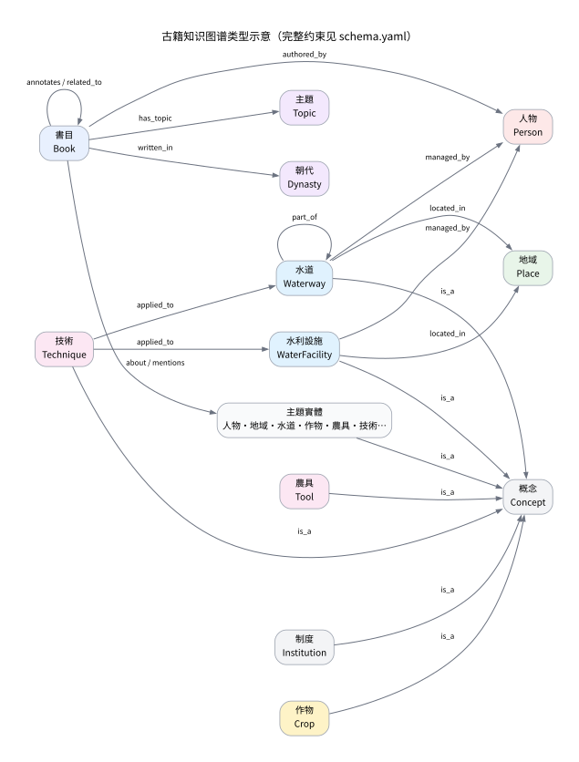
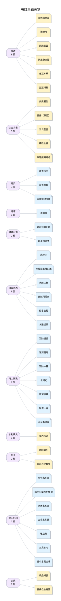

# 古籍知识图谱

本目录把 [`books/`](../books/) 中的 **42 部**农业、水利、荒政、时令与禹贡古籍整理为可查询的知识图谱。图谱不是全文检索的替代品，而是把书目、人物、水道、水利设施、作物、农具、技术与制度之间的关系显式化，并为每条关系保留可核对的原文引文。

当前版本：

- **42 部**书，**838 卷/篇**，约 **783.5 万字**
- **238 个实体**（含 27 个消歧辅助实体），**789 条关系**
- 其中 **603 条关系带原文引文**，构建时逐条校验引文确实出现在对应古籍全文中
- 人工标註的「主题论述」158 条，别名匹配自动抽取的「提及」401 条





## 实体类型

| 类型 | 说明 | 示例 |
|---|---|---|
| `Book` 書目 | 仓库收录的一部古籍 | 《齊民要術》《河防一覽》 |
| `Person` 人物 | 作者、治河官员、农学家 | 賈思勰、潘季馴、徐光啟 |
| `Dynasty` 朝代 | 书目所属朝代 | 後魏、宋、元、明、清 |
| `Place` 地域 | 历史地理区域、城市、山脉、海域 | 江南、三吳、關中、寧波、崑崙 |
| `Waterway` 水道 | 河流、湖泊、运河 | 黃河、長江、太湖、大運河 |
| `WaterFacility` 水利設施 | 堤、埽、閘、堰、陂塘、圩、海塘、水庫 | 堤防、埽工、它山堰 |
| `Crop` 作物 | 粮食、纤维、油料、救荒植物 | 稻、麥、粟、桑、棉、蕎麥 |
| `Tool` 農具 | 耕作、播种、收获、脱粒、提水器具 | 犁、耬車、龍骨車、龍尾車 |
| `Technique` 技術 | 耕作、栽培、水利、救荒技术 | 區田、糞田、束水攻沙、捕蝗 |
| `Institution` 制度 | 荒政、仓储、漕运、河工制度 | 常平倉、義倉、社倉、河工 |
| `Topic` 主題 | 由 `catalog.yaml` 的 `topic` 归纳的书目主题 | 荒政、河工防洪、禹贡 |
| `Concept` 概念 | 用于组织分类的抽象类目 | 農具、穀物、治河方略 |

完整的实体清单、说明与主要书目见 [`INDEX.md`](INDEX.md)。

## 关系类型

| 关系 | 方向 | 说明 | 证据 |
|---|---|---|---|
| `has_topic` | 書目 → 主題 | 书目主题分类 | `catalog.yaml` |
| `written_in` | 書目 → 朝代 | 成书朝代 | `catalog.yaml` |
| `authored_by` | 書目 → 人物 | 作者；仅当作者字串能对应人物实体时生成 | `catalog.yaml` |
| `about` | 書目 → 主题实体 | 人工标註的核心论题；引文自动取自正文 | 原文 |
| `mentions` | 書目 → 主题实体 | 正文出现某一实体；别名最长匹配，`count` 为次数 | 原文 |
| `annotates` | 書目 → 書目 | 注释、集释、订讹关系 | 原文 |
| `related_to` | 書目 → 書目 | 题材、编纂或学术脉络相关 | 原文 |
| `is_a` | 具体实体 → 概念 | 分类层次 | 编者设定 |
| `part_of` | 水道/设施/地域 → 水系/地域 | 水系隶属 | 原文 |
| `located_in` | 水道/设施/地域 → 地域 | 地理位置 | 原文 |
| `managed_by` | 水道/设施 → 人物 | 主持治理者 | 原文 |
| `applied_to` | 技術 → 水道/设施 | 技术施用对象 | 原文 |

`about` 与 `mentions` 的区别很重要：`about` 是人工判断的「该书以此为主题之一」，`mentions` 只是「正文中出现过这个词」。前者适合回答“哪部书讲区田/海塘/荒政”，后者适合做词语索引与共现分析。

## 文件

| 文件 | 内容 |
|---|---|
| `schema.yaml` | 实体类型、关系类型及其 domain/range 约束，是图谱的 schema 源文件 |
| `data/entities.yaml` | 人工整理的主题实体、别名与说明 |
| `data/relations.yaml` | 人工整理的语义关系及原文引文 |
| `data/about.yaml` | 书目与核心主题实体的对应 |
| `data/topics.yaml` | 主题、朝代的稳定 ID 与说明 |
| `build.py` | 构建、校验、生成 `graph.json`、JSONL、JSON-LD、`INDEX.md` 与 `schema.svg` |
| `query.py` | 命令行查询工具 |
| `graph.json` | 完整图谱：meta、schema、stats、entities、relations |
| `entities.jsonl` / `relations.jsonl` | 逐行 JSON，便于导入图数据库或数据处理管线 |
| `graph.jsonld` | JSON-LD 导出，便于语义网工具读取；使用仓库路径作为本地 IRI 前缀，不是已发布的正式本体 |
| `INDEX.md` | 自动生成的人读索引：书目、主题、实体、语义关系 |
| `schema.svg` / `overview.svg` | 自动生成的类型示意图与书目主题总览 |

## 构建与校验

依赖 Python 3.9+、PyYAML；生成示意图需要 Graphviz `dot`。

```bash
python3 kg/build.py          # 构建并校验
python3 kg/build.py --scan   # 只打印每部书的实体提及统计，便于整理
python3 kg/build.py --no-svg # 跳过 Graphviz 渲染
```

构建会检查：

1. 实体 ID 唯一、类型在 `schema.yaml` 中定义；
2. 关系的主语/宾语存在，且类型符合 domain/range；
3. `about` 指定的实体确实在对应书目中出现；
4. 所有带引文的关系，其 `quote` 逐字出现在对应古籍全文中；
5. 别名冲突（同一别名指向两个实体）直接报错。

任何一条引文无法在原文中找到，构建都会失败并指出关系 ID 与引文。这样可以避免手工整理时把不同书的引文串位。

## 查询

```bash
python3 kg/query.py stats
python3 kg/query.py search 黃河
python3 kg/query.py show water:huanghe
python3 kg/query.py neighbors water:huanghe --depth 2
python3 kg/query.py books --topic 荒政
python3 kg/query.py books --dynasty 清 --category 水利
python3 kg/query.py evidence water:huanghe
```

也可以直接读取 `graph.json`：

```python
import json

graph = json.load(open("kg/graph.json"))
entities = {entity["id"]: entity for entity in graph["entities"]}
for relation in graph["relations"]:
    if relation["predicate"] == "about":
        print(entities[relation["subject"]]["name"], "→", entities[relation["object"]]["name"])
```

## 整理规则

- **书目层自动生成**：书目、作者、朝代、主题、卷数、字数来自 `books/catalog.json`，避免与全文目录重复维护。
- **主题实体人工整理**：`data/entities.yaml` 中的实体、别名与说明由人工维护；单字别名（如「桑」「稷」「犁」）容易与地名、人名同形，因此另设「消歧辅助实体」，用最长匹配把「伊犁」「桑欽」「社稷」等排除在外。
- **`about` 人工标註、引文自动定位**：`data/about.yaml` 只写书目与实体 ID；构建脚本到正文中找第一个有上下文的出现位置，跳过卷端题名、四庫分類標目和书名行。
- **`mentions` 自动抽取**：对全部书目做别名最长匹配，统计出现次数，每部书保留次数最多的若干实体；它表示“正文出现过”，不表示“该书主张什么”。
- **语义关系人工整理**：`data/relations.yaml` 中的水系隶属、地理位置、治理者、技术施用、书目注释与关联均带原文引文；`is_a` 分类关系属于编者设定，不需要引文。
- **不破坏原文**：图谱只引用 `books/` 中已有的转录文本，不改动古籍正文；所有引文可在对应 Markdown 文件中直接检索到。

## 覆盖与局限

- 这不是全自动的 NLP 抽取，而是「人工整理实体与语义关系 + 自动别名匹配 + 原文校验」的混合图谱。主题实体表覆盖农业、水利、荒政、时令与禹贡的核心概念，但不追求穷尽所有人名、地名与物名。
- `mentions` 的计数是别名匹配结果，受异体字、通假字、地名与人名同形影响；已为高风险单字设置消歧实体，但仍可能有少量误匹配。引用计数时应结合 `about` 与原文复核。
- 每部书只标註 2—5 个核心主题实体，`about` 不是该书主题的完整清单。
- 历史地名、水道变迁与行政区划按古籍语境简化处理，不构成现代地理坐标；需要精确历史地理检索时请核对原书与专门工具。
- 古籍转录本身可能有 OCR 或录入讹误；图谱引文与转录一致，但不保证转录无误。版本与文本局限详见 [`../SOURCES.md`](../SOURCES.md)。

## 许可

古籍底本属于公有领域；Kanripo 转录文本以 [CC BY-SA 4.0](../LICENSE) 许可发布。本目录的图谱数据、构建脚本与说明同样遵循 CC BY-SA 4.0。再分发时请保留 [`../SOURCES.md`](../SOURCES.md) 中的署名说明。
