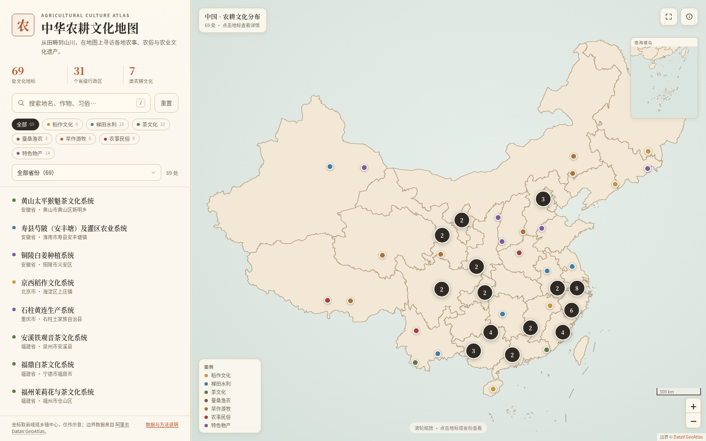

# 中华农耕文化地图

一个可交互的地域农耕文化 GIS Web 服务：在中国地图上浏览各地传统农耕系统、农事习俗与农业文化遗产，按类别、省份和关键词筛选，点击地标查看介绍、遗产身份与资料来源。



## 快速开始

```bash
python3 web/server.py
# 打开 http://127.0.0.1:8000/
```

服务只依赖 Python 3.9+ 标准库；只有重新生成数据时才需要 `PyYAML`（已在仓库根目录 `requirements.txt` 中）。

也可以只做静态托管：

```bash
python3 -m http.server 8000 --directory web
```

此时页面与地图可用，但 `/api/*` 接口不可用。

## 功能

- **地图浏览**：省级行政区底图、分类着色地标、聚合与缩放，南海诸岛小图。
- **筛选**：7 个类别、31 个省级行政区、关键词搜索（地名、作物、习俗、遗产名称）。
- **详情**：一句话介绍、农事与习俗、遗产身份、关键词、资料来源、示意坐标。
- **深链接**：`#site=qingtian-rice-fish`、`#cat=tea&prov=浙江省&q=龙井` 可直接分享筛选与详情状态。
- **可访问性**：键盘操作、焦点管理、`aria` 标注、减少动效偏好；移动端为抽屉式筛选与底部详情。
- **无外部运行时依赖**：Leaflet 与 MarkerCluster 已随仓库提供，地图不依赖在线瓦片，离线也能展示。

## 数据

| 文件 | 说明 |
| --- | --- |
| [`data/sites.yaml`](data/sites.yaml) | 权威站点数据，人工维护 |
| [`data/sites.geojson`](data/sites.geojson) | 由 YAML 生成的 GeoJSON，页面实际读取 |
| [`data/provinces.geojson`](data/provinces.geojson) | 省级行政区边界（阿里云 DataV.GeoAtlas） |
| [`data/stats.json`](data/stats.json) | 统计与更新时间，页面与接口共用 |

当前收录 **69 处** 站点，覆盖 **31 个省级行政区**、**7 类**农耕文化：

| 类别 | 数量 | 示例 |
| --- | ---: | --- |
| 稻作文化 | 9 | 青田稻鱼共生、从江稻鱼鸭、万年稻作 |
| 梯田水利 | 18 | 哈尼梯田、都江堰、坎儿井、木兰陂 |
| 茶文化 | 10 | 西湖龙井、安溪铁观音、普洱古茶 |
| 蚕桑渔农 | 3 | 湖州桑基鱼塘、吴江蚕桑、佛山基塘 |
| 旱作游牧 | 6 | 敖汉旱作、涉县石堰梯田、阿鲁科尔沁游牧 |
| 农事民俗 | 9 | 二十四节气、蚂拐节、望果节、纳顿节 |
| 特色物产 | 14 | 宣化葡萄、绍兴香榧、中宁枸杞、哈密瓜 |

站点名录与认定年份参考农业农村部“中国重要农业文化遗产”名录、联合国粮农组织“全球重要农业文化遗产”名录、中国非物质文化遗产网、世界灌溉工程遗产名录等公开资料；每个站点在详情中列出对应来源。数据来源、整理方法与局限见 [`data/SOURCES.md`](data/SOURCES.md)。

## 新增或修订站点

1. 在 [`data/sites.yaml`](data/sites.yaml) 中新增条目，字段说明见文件顶部注释。
2. 运行构建与校验：

   ```bash
   python3 web/build_data.py
   ```

   脚本会检查必填字段、ID 唯一性、类别、来源 URL、坐标范围，并用省级多边形校验“坐标是否落在所声明的省份内”。校验失败会指出具体站点。
3. 刷新页面即可。若只修改了介绍文字，也需要重新生成 `sites.geojson`。

`python3 web/build_data.py --check` 只校验并检查生成文件是否最新，适合 CI。

## JSON API

`web/server.py` 在静态站点之外提供只读接口：

```bash
curl http://127.0.0.1:8000/api/health
curl http://127.0.0.1:8000/api/stats
curl 'http://127.0.0.1:8000/api/sites?category=tea&province=浙江省&q=龙井'
curl http://127.0.0.1:8000/api/sites/qingtian-rice-fish
```

- `GET /api/health`：服务状态、站点数、省级行政区数、数据更新时间。
- `GET /api/stats`：分类与省份计数。
- `GET /api/sites`：GeoJSON；可选 `category`、`province`、`q` 参数。
- `GET /api/sites/<id>`：单个 Feature。
- 未知类别返回 400，未知站点返回 404。

## 测试

```bash
python3 -m unittest discover -s tests -v
```

测试覆盖数据模式、坐标落省校验、生成文件是否最新、统计一致性，以及静态页面与 API 的主要响应。

## 目录

```text
web/
├── index.html              # 页面结构
├── assets/
│   ├── app.js              # 地图、筛选、详情、深链接
│   └── style.css           # 宣纸/赭石/青绿视觉
├── data/
│   ├── sites.yaml          # 权威数据
│   ├── sites.geojson       # 生成数据
│   ├── provinces.geojson   # 省级边界
│   ├── stats.json          # 统计
│   └── SOURCES.md          # 来源与局限
├── docs/                   # 截图
├── vendor/                 # Leaflet / MarkerCluster 及许可
├── build_data.py           # 校验 + 生成
└── server.py               # 静态站点 + JSON API
```

## 说明与局限

- 站点坐标取县域或乡镇中心，精确到小数点后两位，**仅作定位示意**，不代表遗产地精确边界。
- 介绍文字为编者根据公开资料综述，遗产名称与认定年份以原始资料为准；名录会更新，欢迎提交修订。
- 省级边界来自阿里云 DataV.GeoAtlas，仅用于学习研究，不作为主权或行政界线依据。
- 当前以文字和地图为主，未收录图片；这是为了保持仓库轻量并避免引入未授权图片。

## 许可与致谢

- 本页新增的代码、站点介绍与整理数据遵循仓库的 [CC BY-SA 4.0](../LICENSE)。
- 地图库 [Leaflet](https://leafletjs.com/)（BSD-2-Clause）与 [Leaflet.markercluster](https://github.com/Leaflet/Leaflet.markercluster)（MIT）的许可文本见 [`vendor/`](vendor/)。
- 省级边界数据 © [阿里云 DataV.GeoAtlas](https://datav.aliyun.com/portal/school/atlas/area_selector)。
